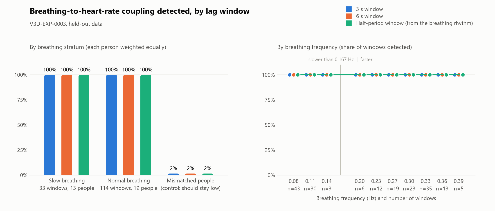
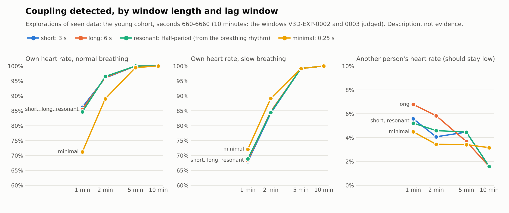

# rain-pipeline

**A hypothesis can fail. Its evidence should remain standing.**

This is the reproducibility instrument behind a simple challenge: could someone inspect not only a scientific result, but the rules that were in force *before* the result appeared?

[**Inspect the failed experiment →**](runs/20261004T174209Z/REPORT.md) · [**Read a passed run →**](runs/20261004T181106Z/REPORT.md) · [**See what the data could decide →**](#vii-the-dress-rehearsal-nobody-held) · [**Set up and replay →**](#x-setup) · [**Verify the evidence chain →**](docs/EVIDENCE.md) · [**Current R.A.I.N. Lab →**](https://github.com/topherchris420/lop-nur-twin)

**Four things to inspect first:**

| Question | Where the answer lives | Boundary |
| --- | --- | --- |
| What was decided before the data? | [Registered experiment specs](experiments/) and their Git history | A registration can be verified; it cannot prove no out-of-band data access occurred |
| What did the held-out records show? | [The recorded results](#vi-the-record), including a **failed** test | A run can test its registered hypothesis, not every interpretation of its graphs |
| Could another machine regenerate the numerical result? | [Replay receipts](replays/) and [verification contracts](docs/EVIDENCE.md) | Matching computations do not constitute independent replication with new subjects |
| Could the data have answered otherwise? | [The rehearsal](#vii-the-dress-rehearsal-nobody-held) of each registration's criteria on its own exploration | A rehearsal speaks for data like the exploration's; a holdout can still differ, which is why it is read |

The pipeline uses a **pinned historical R.A.I.N. version** from the former `james_library` as a submodule. The [current integrated R.A.I.N. Lab](https://github.com/topherchris420/lop-nur-twin) lives in Lop Nur Twin; these experiments remain tied to the versions that originally produced them.

### A mathematical question worth testing

**Can a preregistered effect survive a subject-level holdout and a falsifying negative control?** The [proposed study](docs/MATH_RESEARCH.md) names assumptions, an existing baseline and a negative control. Candidate mathematics can be explored through [R.A.I.N.'s shared reference scout](https://github.com/topherchris420/lop-nur-twin/blob/main/docs/MATH_PORTFOLIO.md). **No additional mathematical capability has been demonstrated here yet.**

## A note 

I built **rain-pipeline** because I kept running into the same problem from different directions: a scientific result can look rigorous long before anyone has a reliable way to separate what was *noticed*, what was *measured*, and what was actually allowed to count as evidence.

I do not want another system that asks the reader to trust the researcher, the model, the paper, or even the software. I want the machinery of the claim to be visible.

That is the idea behind this repository. I am building a research system in which an observation can remain an observation, a hypothesis can be registered before it is tested, evidence can be tied to the exact bytes and code that produced it, failures can stay in the record, and another person can replay the result without needing to believe me first.

This is also how I think about my broader work at **Vers3Dynamics**. The point is not to manufacture certainty. The point is to build instruments that make uncertainty, provenance, and evidence harder to hide.

I am particularly interested in the boundary between human judgment and machine judgment. R.A.I.N. is not here to become an oracle. It is here to make the rules explicit, apply them consistently, and leave a trail that someone else can inspect.

So this README is intentionally a little more personal than a normal software README. The code is the artifact. The repository is the laboratory notebook. And the standard I am trying to hold myself to is simple:

> **Do not ask people to trust the result when you can give them the means to check it.**

Everything that follows is an attempt to make that sentence executable.

*From here the page is presented by a counsel in the manner of Edward Bernays, who sold a distinction before he sold a product. The "relation in Vienna" is his, not mine, and Section XV names every device he uses on you.*

## I. The problem is not dishonesty

The conscious and intelligent separation of what a researcher has *noticed* from what a researcher has *shown* is an important element in modern science. Those who maintain that separation constitute an invisible discipline. That discipline, not the eminence of the researcher and not the confidence of the prose, is the true source of a result's authority.

We're persuaded, our confidence won and our doubts settled, largely by mechanisms we have never examined. This is the natural consequence of the way the modern laboratory is organised. One mind looks at the data, forms a wish, writes the criteria, takes the measurement and announces the verdict; and the public, having no means of telling these five acts apart, hears them in one voice.

rain-pipeline is an instrument for giving them separate voices. It takes a question to a verdict on real data, and it keeps four things from being mistaken for one another:

| | where it lives | may it decide a verdict? |
|---|---|---|
| something we **noticed** | `explorations/`: analyses of data already seen, labelled exploratory | never |
| something we **registered** | `experiments/<ID>/experiment.json`: write-once criteria, anchored by a git commit before the data is read | it defines what would |
| something we **measured** | `runs/` and the R.A.I.N. run record: the registered measurements, each bound by hash to the bytes it came from | no; it is the input |
| something the **registered criteria support** | the verdict R.A.I.N. computes from those measurements and those criteria alone | yes, and nothing else does |

## II. Four sentences the public can carry

The group mind does not carry arguments. It carries phrases, and a principle the public can repeat is worth more than a proof it cannot. The instrument rests on four.

- **Inference is not evidence.** Explorations, the literature panel and every output a study computes but did not register stay description. None of them is ever submitted or evaluated.
- **Evidence is not permission.** A result cannot change its own criteria, reuse a holdout it has read, or speak for subjects it never saw. Registrations are write-once and git-anchored; a holdout is read once.
- **Confidence is not authority.** A verdict is as strong as the chain beneath it, no stronger. `verify` re-derives every link and grades every claim; `replay` re-executes it.
- **Agreement is not a test.** Two arms that decide every window alike have compared nothing, however early their criteria were written. `rehearse` counts, before the data is read, the windows on which a registration's arms could disagree; `register` binds the count.

## III. On the wish, which is older than the observation

A relation of mine in Vienna spent his life demonstrating that the wish precedes the perception, and that the mind which holds the wish is the last to be told of it. Researchers who look at the data and then write the criteria are not frauds. They are human beings, and the ordinary laws of the human mind apply to them with full force.

Every earlier remedy asked researchers to be better than that. This instrument asks nothing of the kind. It assumes the wish, and it arranges matters so that the wish does not matter. The criteria are written down, sealed by hash, committed to a public history and pushed before the pipeline first reads the designated holdout data; its ledger timestamps that first read. This makes the recorded process auditable. It cannot detect earlier or outside-the-tool access, and the author can still modify a public repository. The point is to expose the sequence, not declare the researcher's judgment infallible.

## IV. Four separate roles, no borrowed authority

The strongest experiment is not the one with the most impressive referee. It is the one in which you can name **who did which step**, and check that no step quietly performed another's job.

The pipeline separates four roles. **They are not four independent certifiers:** the researcher maintains this software, writes the criteria and chooses what to investigate. The separation is implemented by contracts and recorded provenance, not by an external review board.

- **R.A.I.N., the rules engine.** The pinned historical version evaluates submitted measurements against registered criteria. A run cannot declare its own verdict; the author's software still defines how the criteria are evaluated.
- **Anna, the librarian.** Its cited literature record is sealed and re-verified by hash. Literature can inform a question but cannot overwrite criteria after registration.
- **PhysioNet, the external data source.** The Fantasia byte ranges read through the pipeline are logged with hashes, first-access times and reader identity. Replay refuses changed bytes. The ledger **cannot detect data read outside this pipeline**.
- **Git history, the public timeline.** A registration in a pushed commit is independently inspectable. It establishes the visible order of recorded commits and results, not a guarantee about everything the researcher did privately.

The aim is to make mistakes and interventions easier to detect and explain, **not** to claim external certification or perfect prevention of hindsight bias.

Each stage calls the upstream code in-process at a pinned commit (Anna, R.A.I.N. and DRR are submodules under `vendor/`). Nothing is copied or forked. Every run records which code ran, and `verify` maps that record back to the exact commit.

## V. The overt act

Opinion is not moved by argument. It is moved by an event the public can witness. When a nation was to be reminded what it owed the electric lamp, the counsel did not publish an essay; he arranged for the lamps of a continent to be dimmed and relit at an appointed hour, with the inventor present.

The event this instrument stages is smaller, and it is public. On 4 October 2026, at 17:41:53 UTC, commit `4b4a030` placed the criteria for V3D-EXP-0002 and V3D-EXP-0003 in the history of this repository, and that commit was pushed before the first byte of their held-out data was read. The commit, the push and the ledger are all open to inspection, and a reader who inspects them concludes without taking anyone's word for it.

The mechanism, in full:

```
question
  ├─ explore ──── seen bytes only, labelled "not evidence" ──────────────────────┐ (hash)
  ▼                                                                              ▼
register ── refuses first: malformed spec, a definition R.A.I.N. rejects, a metric the study never
         │  produces, an unguarded or already-read holdout, an unacknowledged shared holdout
         ├─ Anna: arXiv → hybrid search → cited record, sealed + re-verified
         ├─ R.A.I.N. panel argues over Anna's sources (context, never criteria)
         ├─ rehearsal: the criteria on the exploration, by R.A.I.N.'s evaluator. Settled? Blind contrasts?
         │  A rival the criteria cannot tell apart? (description; reads no data)
         └─ write-once rain-experiment/v1 binding, by SHA-256: literature record, panel corpus,
            parent result, exploration, rehearsal, holdout ranges, the ledger as it was
git commit + push ── the anchor: the first commit that holds the registration
run ── refuses an unanchored or edited registration, a changed dossier, (holdout) unpinned code
    ├─ PhysioNet byte ranges, each first read logged once in the append-only data/ledger.json
    ├─ DRR study: real pairs + mismatched-person + synthetic positive and null controls
    └─ submission with no status ─► R.A.I.N. alone evaluates the registered criteria
         (any failure after the first read is still filed: an `error` run, never a lost one)
verify ── re-derives every link from the files and git history (the rehearsal too); grades each claim
replay ── re-executes a run from its registration alone; writes a receipt comparing every value
```

## VI. The record

The counsel's first instinct is to lead with a success. The counsel's considered advice is to lead with the failure, because a method that has never reported one has never been tested, and the public knows it.

Of three registered experiments, one failed. Its criteria were pushed to a public server before the data was read; the data was read; the hypothesis did not hold; the verdict was filed and published unchanged. That row is the strongest claim this repository makes.

| experiment | question | data | verdict (assigned by R.A.I.N.) | evidence level |
|---|---|---|---|---|
| [V3D-EXP-0001](runs/20261004T150406Z/REPORT.md) | Does DRR recover respiration → heart-rate coupling at rest? | 20 people × 10 min | **PASSED**: 18 of 20 detected; 1 of 20 mismatched pairs | registered: criteria recorded before the run, not git-anchored |
| [V3D-EXP-0002](runs/20261004T174209Z/REPORT.md) | Do slow breathers escape a 3 s lag window, and does 6 s recover them? | held out: 190 windows | **FAILED** (F1): nothing to recover; 3 s already detected 33 of 33 slow windows | confirmatory: anchored in `4b4a030` and pushed before any holdout byte was read |
| [V3D-EXP-0003](runs/20261004T181106Z/REPORT.md) | Can the lag window come from the breathing rhythm (half its period)? | held out: 190 windows | **PASSED**, at ceiling: matches both fixed windows (100%); mismatched 3 of 190 | confirmatory: same anchor, same held-out windows as 0002 |

Evidence levels follow mechanically from `python -m rain_pipeline verify` ([how](docs/EVIDENCE.md)); `python -m rain_pipeline lineage` prints the chain behind each row. Two facts the levels make explicit, and the counsel is instructed not to soften: V3D-EXP-0002 and 0003 form a family judged on the same held-out bytes with no correction across them, and their held-out data is new data from the same 20 people, not new people.

**Replays.** A result the public can only read is a rumour. A result the public can re-execute is a fact. Each run was re-executed from its registration alone, from the public PhysioNet bytes (every byte hash-identical to the ledger), by the committed 0.3.0 code on Linux; the originals ran on Windows. Receipts are in `replays/`, and `verify` checks each one against the record it replays.

| run | receipt | outcome | registered measurements | largest descriptive difference |
|---|---|---|---|---|
| V3D-EXP-0001-RUN-0001 | [2026-10-04, Python 3.11.15, numpy 2.4.6, scipy 1.17.1](replays/V3D-EXP-0001/RUN-0001-20261004T200834Z.json) | `measurements-reproduced` | 11 of 11 identical, same verdict | 7.3e-15 |
| V3D-EXP-0002-RUN-0001 | [2026-10-04, Python 3.11.15, numpy 2.4.6, scipy 1.17.1](replays/V3D-EXP-0002/RUN-0001-20261004T201606Z.json) | `measurements-reproduced` | 24 of 24 identical, same verdict | 7.9e-15 |
| V3D-EXP-0003-RUN-0001 | [2026-10-04, Python 3.11.15, numpy 2.4.6, scipy 1.17.1](replays/V3D-EXP-0003/RUN-0001-20261004T202718Z.json) | `measurements-reproduced` | 24 of 24 identical, same verdict | 7.9e-15 |

The largest difference between any original and its replay is eight parts in a quadrillion.



*The interpretation below was written after the runs, in 0.2.0. It mixes registered outcomes (the verdicts and detection rates) with description (correlation sizes, lags, QC observations); only the registered outcomes are evidence. The counsel has been permitted to touch the wording and not the numbers.*

### What the held-out data says

V3D-EXP-0001 missed two people, f2y09 and f2y10, who both breathe slowly. That suggested the 3 s lag window was too short for slow breathing. Two experiments put the suggestion to 6,000 s per person that had never been read, with their criteria pushed to GitHub (`4b4a030`) before the first byte was fetched. The idea did not survive, and the record of its end is intact:

- **The coupling is too strong to miss in 10 minutes.** Within a person, breathing and heart rate correlate at a median |r| of 0.53, against 0.055 for mismatched people. Under the 3 s window, 171 of 190 windows reach the smallest p-value 199 surrogates allow (0.005), and none exceeds 0.020. Every lag window detects every window, including 43 windows breathing slower than the slow stratum (0.063–0.078 Hz).
- **So V3D-EXP-0002 fails, and V3D-EXP-0003's pass is weak.** The 6 s window had no gain to show. The breathing-derived window matched both fixed windows at 100%, which shows neither a cost nor a benefit. Most windows sat at the smallest p-value 199 surrogates allow (176 of 190 for the derived window), where the cost of searching more lags cannot appear; off that floor, on 20 windows, its p-value was lower than the 3 s window's in 6 and higher in 1. Both outcomes stand as registered. [Section VII](#vii-the-dress-rehearsal-nobody-held) shows that neither could have come out otherwise.
- **Truncation is real but rare.** *Description, not evidence.* In 6 of 76 slow or very slow windows, the 3 s window's best lag sat at its 3 s edge. The 6 s window found the true peak further out in 5 of them, with a lower p-value. None changed a detection.
- **f2y09's miss looks like signal quality, not lag.** All 10 of its held-out windows fail the pre-registered beat QC (86–94% valid RR intervals). Its V3D-EXP-0001 window passed at 95.3%, just over the 95% bar, and showed almost no coupling (|r| 0.03). Noisy ECG or frequent ectopic beats would both do this; the band-pass detector cannot tell which. f2y10 is detected in all 10 held-out windows; its V3D-EXP-0001 window was the exception.
- **The exploration's warning did not replicate.** On seen data the 6 s window fired on 4 of 20 mismatched pairs. On held-out data each lag window fired on 3 of 190.

Earlier on V3D-EXP-0001: heart rate → respiration was also detected in 90% of records, as its pre-registered limitation predicted, so it shows coupling, not direction. Its first attempt (`runs/20261004T145937Z`) crashed before submitting and is kept with a `CRASHED.txt`.

## VII. The dress rehearsal nobody held

The counsel has a confession to make, and by the rule of Section VI it goes where the boast would go.

Section VI is true, and it is less than it looks. The exploration bound into both held-out registrations on 4 October already held both verdicts. On its 20 seen windows, the 3 s, 6 s and breathing-derived lag windows did not once disagree about a person's own breathing and heart rate. A gain of one window over another cannot be measured where the windows never differ, so every same-person comparison V3D-EXP-0002 and 0003 registered was zero before a held-out byte was read. The instrument proved that the criteria came first. It had no way to ask whether the data could have answered them otherwise.

Version 0.4.0 asks. `rehearse` applies a registration's criteria, through R.A.I.N.'s own evaluator, to the tests its exploration already ran: no new test, no new byte. Put to the two experiments after the fact, on the exploration each registration bound:

| registration | rehearsed on (bound at registration; seen data) | as observed | the same verdict, over resamples of its 20 people | contrasts whose arms never disagree | the holdout then said |
|---|---|---|---|---|---|
| V3D-EXP-0002 | `explorations/20261004T173027Z-explore-lag-window` | failed | 1,000 of 1,000 | slow gain and normal change, 6 s against 3 s | failed |
| V3D-EXP-0003 | `explorations/20261004T173027Z-explore-lag-window` | passed | 911 of 1,000 | slow and normal, derived against fixed | passed |

V3D-EXP-0002's verdict was settled: its gain could only be zero, and zero was its failure criterion. V3D-EXP-0003's contrasts could only be zero as well; across resamples its verdict moved only with the mismatched-people control and with whether a resample drew any slow breather at all. Neither verdict changes, and neither evidence level: both experiments were registered, anchored, pushed and judged exactly as the record says. What changes is what they are worth. Each confirms that a pattern seen on 20 windows held on 190 new ones. Neither could have shown that one lag window beats another.

### A rival the hypothesis rejects

The derived window rests on an argument: two signals that share a rhythm correlate most strongly once every half period, so only a window of at least half a period is sure to contain that peak. If the argument mattered here, a window too short to honour it should lose. [`explorations/20261021T161159Z-explore-minimal-window`](explorations/20261021T161159Z-explore-minimal-window/report.json) re-runs V3D-EXP-0003's analysis on its own 190 held-out windows, now seen, and adds one arm: a window one sample wide, testing lag 0.25 s and nothing else. Every one of the 1,320 tests the registered run recorded comes back with identical p-values and lags.

The one-sample window detects 189 of the 190 windows, all 33 slow-breathing windows among them. The one it misses breathes at 0.078 Hz, slower than either stratum. It fires on 6 of 190 mismatched pairs, against 3 for the other windows. Rehearsed in its place (`rehearse specs/resonance-derived-window.json --on explorations/20261021T161159Z-explore-minimal-window`), every criterion V3D-EXP-0003 applies to the real recordings comes out as before: S1 to S3 hold and F1 to F3 do not. Only guard G5 tells the two windows apart, and G5 is a synthetic positive control whose coupling sits at lag 4 samples, out of a one-sample window's reach by construction.

*Exploration of seen data: description, not evidence.* In 10-minute windows of these recordings, the lag window does not matter. Respiratory sinus arrhythmia in resting young adults is strong enough that the correlation at a single quarter-second lag clears the surrogate test almost every time.

### Where the ceiling breaks

Section VI asked for shorter windows, chosen by exploring seen data first. Three explorations cut the young cohort's 6,000 seen seconds into 5, 2 and 1 minute windows ([300 s](explorations/20261021T172445Z-explore-window-300s/report.json), [120 s](explorations/20261021T170046Z-explore-window-120s/report.json), [60 s](explorations/20261021T171245Z-explore-window-60s/report.json)), under the same four lag windows. *Explorations of seen data: description, not evidence.*



Detection, in percent, for the 3 s · 6 s · derived · one-sample lag windows (same-person rates weight each person equally), and what the two registered experiments' criteria give when rehearsed on each exploration:

| window | windows (people) | normal breathing | slow breathing | mismatched people | V3D-EXP-0002's criteria | V3D-EXP-0003's criteria |
|---|---|---|---|---|---|---|
| 10 min | 190 (19) | 100 · 100 · 100 · 100 | 100 · 100 · 100 · 100 | 1.6 · 1.6 · 1.6 · 3.2 | failed, 1,000 of 1,000, blind | passed, 1,000 of 1,000, blind |
| 5 min | 381 (20) | 100 · 100 · 100 · 99.5 | 99.2 · 99.2 · 99.2 · 99.2 | 4.5 · 3.7 · 4.5 · 3.4 | failed, 1,000 of 1,000, blind | passed, 1,000 of 1,000, blind |
| 2 min | 959 (20) | 96.0 · 96.2 · 96.5 · 89.0 | 84.1 · 84.7 · 84.4 · 89.1 | 4.1 · 5.8 · 4.6 · 3.4 | inconclusive, 686 of 1,000 | passed, 1,000 of 1,000 |
| 1 min | 1,918 (20) | 86.2 · 85.5 · 84.6 · 71.2 | 67.9 · 68.3 · 68.9 · 72.1 | 5.6 · 6.8 · 5.2 · 4.5 | inconclusive, 1,000 of 1,000 | passed, 1,000 of 1,000 |

- **The ceiling breaks between five minutes and two.** At five minutes, 99% of windows are detected, and the 3 s, 6 s and derived windows still decide every one alike. At two minutes detection falls to 92–93%, and at one minute to 81–82%.
- **The 3 s, 6 s and derived windows never separate.** At every length their rates stay within two points of each other. That is inside V3D-EXP-0003's five-point margin and far from V3D-EXP-0002's ten-point gain, so the first is settled PASSED at every length and the second never passes. Shorter windows give the arms room to disagree; these three barely use it.
- **The one-sample window moves, in two directions at once.** Against the 3 s window it *gains* on slow breathers (+5.0 points at two minutes, +4.2 at one) and loses on normal ones (−7.0 and −15.0). The half-period argument predicts the opposite. A likely reason, offered as description: detection needs only enough correlation to beat a null that grows with every lag searched. Slow breathing broadens the correlation peak, so a narrow window loses little signal there and pays no search cost; normal breathing sharpens the peak, and a narrow window can miss it.
- **Mismatched people** stay between 1.6% and 6.8% under every window, with no consistent ordering by width.
- **f2y09**, excluded from every 10-minute window by beat QC, passes in 10 of 50 two-minute windows and 26 of 100 one-minute ones. A beat detector that flags ectopic beats would show whether the rest can be analysed.

### What changes

From 0.4.0 the rehearsal is held before the performance. Whenever a spec names its exploration, `register` rehearses the criteria on it, writes the result into the framing dossier and binds it into the registration by hash, in the same commit as the criteria. `verify` derives it again, `lineage` summarises it, and every run's `REPORT.md` prints it beside the verdict. A future confirmatory claim carries both answers on the record: the criteria came first, and this is what the data could have said.

### The next experiment, drafted and rehearsed

[`specs/narrow-window-elderly.json`](specs/narrow-window-elderly.json) turns the one result that moved into a registration that could fail. It predicts the two-way effect in the elderly cohort (f1o/f2o): twenty people no experiment has read, with weaker age-related coupling, in 2-minute windows of seconds 60–6060. Against the 3 s window, a one-sample window should lose at least 3 points on normal breathers and no more than 2 on slow ones. If it loses slow breathers by more than 5 points, the half-period argument was right, and F1 records it.

**It is drafted, not registered.** Registration is the researcher's commitment, and its run spends a cohort once. Every check `register` makes before the literature search already passes. Its rehearsal is what a test should look like before its holdout is read (`rehearse specs/narrow-window-elderly.json --on <exploration>`):

| rehearsed on | as observed | the same verdict over 1,000 resamples | contrasts | the 6 s or derived window in the one-sample window's place |
|---|---|---|---|---|
| 2 min windows (the draft's design) | passed | 887: not settled | slow: 25 of 155 windows disagree; normal: 89 of 710 | failed (S1, F2): the criteria tell a narrow window from a wide one |
| 1 min windows | inconclusive | 1,000 | not blind | G6: the 3 s window's synthetic positive control falls to 0.85 |
| 5 min windows | inconclusive | 884 | slow: blind | the ceiling again |

That is why the draft uses two minutes. A rehearsal on young people cannot see old ones, who couple more weakly and may breathe differently. That difference is exactly what the holdout is for.

## VIII. The protocol, and what each step refuses

A guarantee the public can state is worth more than one it must trust. Each step of the protocol is therefore defined by what it refuses to do.

| step | command | guarantee |
|---|---|---|
| explore | `explore SPEC` | Reads only bytes the ledger has already seen; refuses anything else, and refuses a spec that declares a holdout. It checks the ledger and never writes it. The report is labelled *not evidence*. |
| rehearse | `rehearse SPEC` | Applies the spec's criteria to its exploration with R.A.I.N.'s evaluator. Reads no data, runs no test, writes nothing. Reports the verdict data like that gives, how often it recurs over resamples of its people, blind contrasts, and rivals the criteria cannot tell apart. |
| register | `register SPEC` | Refuses before any literature search or data access if the spec is malformed, R.A.I.N. would reject the definition, a registered metric is one the study never produces, a holdout lacks a zero-early-reads guard, any holdout byte was ever read, or the holdout overlaps another registered one without `data.holdout_shared_with`. It then dry-runs the analysis on synthetic data, and rehearses the criteria on the exploration. Writes a write-once registration that binds, by SHA-256, the Anna record, the panel corpus, the parent result, the exploration report, the rehearsal and the ledger snapshot. |
| anchor | `git commit && git push` | The first commit that holds the registration is its timestamp. Every later commit must hold the identical file. GitHub shows the criteria existed before the data was read. |
| run | `run SPEC` | Refuses an uncommitted or edited registration and a framing dossier that no longer matches it. For a holdout it also refuses `--allow-uncommitted` and uncommitted or unpinned code. Holdout reads wait until they are provably later than the anchor. Logs every first read. Submits exactly the registered metrics, with no status, plus `holdout_bytes_read_before_registration` and `holdout_bytes_read_before_anchor` for R.A.I.N. to judge. Any failure after the first read is filed as an `error` run. |
| verify | `verify` | R.A.I.N. re-derives every stored result. Every hash, binding, anchor, ledger version, holdout time and record is re-checked against the files and git history ([checks](docs/EVIDENCE.md#what-verify-checks)). |
| replay | `replay EXP-ID` | Re-executes a recorded run from its registration alone, refuses unseen bytes, and writes a receipt comparing every registered measurement, series and study-report value. |

Registrations never change. If a spec no longer matches its stored registration, `run` refuses and `verify` fails. A changed idea needs a new title, a new spec file and a new registration. A crash after registration is recorded as an R.A.I.N. `error` run, distinct from a failed hypothesis.

The data ledger is a log kept by this tool. It makes the holdout claim checkable and prevents accidents; it cannot rule out reads made outside the pipeline.

## IX. Documentation

- [Architecture](docs/ARCHITECTURE.md): who may decide what, the modules, and every invariant with the mechanism that enforces it and the test that proves it.
- [Protocol](docs/PROTOCOL.md): the contributor contract, what each command refuses, and how to add a study or a data source.
- [Evidence](docs/EVIDENCE.md): every `verify` check, the evidence levels, rehearsals, replay outcomes and receipts, and the evidence graph format.
- [Changelog](CHANGELOG.md): what changed in each version; every run records the version and commit that produced it.

## X. Setup

The counsel does not improve upon the mechanic's instructions. They are reproduced exactly.

```bash
git clone --recurse-submodules https://github.com/topherchris420/rain-pipeline.git
cd rain-pipeline
python3.11 -m venv .venv            # Python 3.10-3.12
.venv/bin/pip install -c constraints.txt -e ".[dev]"
.venv/bin/pip install --no-deps -e vendor/dynamic-resonance-rooting
```

On Windows use `.venv\Scripts\python.exe -m pip …`; with uv, `uv venv --python 3.11 .venv` then `uv pip install --python <venv python> …` with the same arguments.

`constraints.txt` pins the environment the committed results were replayed in. numpy 2.4.6 and scipy 1.17.1 are also what every committed run recorded. Anna, R.A.I.N. and DRR are git submodules under `vendor/`, pinned to the commits that produced the committed results (anna `064af91`, james_library `9c8811e`, DRR `862c4f7`). Moving a submodule or a numeric dependency is a code change: replay the committed experiments, then rely on new results.

Anna needs PostgreSQL. `pgserver` bundles Postgres 16 + pgvector and runs it from `.pgdata/` only while `register` needs it.

## XI. Commands

```bash
python -m rain_pipeline explore specs/explore-lag-window.json
python -m rain_pipeline rehearse specs/<new-spec>.json [--on explorations/<dir>] [--json]
python -m rain_pipeline register specs/<new-spec>.json
python -m rain_pipeline run specs/<registered-spec>.json
python -m rain_pipeline verify [--strict] [--json]
python -m rain_pipeline replay V3D-EXP-0002 [--run RUN-0001] [--no-write]
python -m rain_pipeline lineage [--json]
python -m rain_pipeline publish        # regenerate RESULTS.md from the registry
python -m pytest
```

`rain-pipeline` is installed as the same command. `--root DIR` (or `RAIN_PIPELINE_ROOT`) points every command at another evidence repository.

| exit | meaning |
|---|---|
| 0 | a recorded outcome (passed, failed or inconclusive), a clean verify, or a replay whose registered measurements reproduced |
| 1 | verify found a broken link (or, with `--strict`, a check it could not run), or a replay's measurements or verdict differ |
| 2 | refused: nothing was read, registered or recorded; one line says why |
| 3 | a run or replay was recorded as an error |

- DRR tests run in parallel across CPU cores (spawned workers, each seeded on its own); results are identical to a single process. `RAIN_PIPELINE_WORKERS=1` forces one process.
- The test suite is offline. A fake PhysioNet and a sealed fake Anna record drive the real protocol end to end. One test replays V3D-EXP-0001 from the cached public bytes, and is skipped until `replay` has filled the cache.

## XII. Writing a new experiment

Copy a spec from `specs/` to a **new file name** and edit it. Every section is checked, and every problem is reported at once, before anything runs:

- **`literature`**: arXiv queries for Anna's index, and the search that becomes the cited record.
- **`lineage`** (optional): the result it follows (`V3D-EXP-NNNN/RUN-NNNN`), what was observed, and the exploration report that motivated it (it must be one).
- **`data`**: records, segments, QC. `"holdout": true` makes register and run enforce that the data is unseen. A holdout that overlaps another registered holdout must name it in `"holdout_shared_with"` (and say so in the limitations): the family is then on the record before anything is measured.
- **`analysis`**: the DRR study (`rsa_coupling` or `lag_window`) and its settings, checked against the study's contract. These become the registration's parameters.
- **`preregistration`**: the R.A.I.N. definition: hypothesis, metrics, guards, success and failure criteria, limitations. Every metric must be one the study (or, for a holdout, the pipeline) produces. A holdout needs a guard `{"metric": "holdout_bytes_read_before_anchor", "op": "<=", "value": 0}` (or the `…_before_registration` one).

Before registering, rehearse it: `rehearse specs/<new-spec>.json` applies its criteria to the exploration named in `lineage`. If the verdict is settled, a contrast is blind, or a rival arm (one the hypothesis says should do worse; explore it alongside) earns the same verdict, change what the experiment can see and rehearse again. Do not loosen a margin until it passes. `register` repeats the rehearsal and binds it, so whatever it says is on the record either way.

Only metrics declared in the registration are submitted. Those a criterion reads decide the verdict. The other registered metrics are submitted as description. Everything else a study computes stays in `drr_report.json` as description. Each run's `REPORT.md` lists all three tiers. [docs/PROTOCOL.md](docs/PROTOCOL.md) is the full contributor contract.

## XIII. Layout

| path | what |
|---|---|
| `specs/` | experiment and exploration specs (human intent) |
| `explorations/` | exploratory reports and figures on seen data; never evidence |
| `framing/<spec>/` | Anna record, panel transcript and corpus, the rehearsal, and `framing.json`, fixed at registration |
| `experiments/`, `RESULTS.md` | R.A.I.N.'s registry and its generated results page (do not edit by hand: `verify` compares it with the registry) |
| `runs/<UTC time>/` | `submission.json`, `REPORT.md`, `figure.png`, `drr_report.json`, `summary.json` |
| `replays/<EXP-ID>/` | reproducibility receipts |
| `data/ledger.json` | every byte range read, with its SHA-256 and the time and reader of its first read; append-only |
| `constraints.txt` | the pinned environment |
| `rain_pipeline/` | the code ([architecture](docs/ARCHITECTURE.md)) |

## XIV. What we decline to claim

Candour is a device, and it is the only device that survives a second reading. The limits below are stated by the makers, and stated first, before anyone else can state them.

- **The panel is R.A.I.N.'s offline mode.** Its quotes are verbatim and verified; its reasoning text is scripted. It informs the pre-registration and never writes criteria. When the retrieved abstracts do not address the question, it says so (grounding `none`), as it did for V3D-EXP-0002 and 0003.
- **Anna uses its deterministic hashing embeddings**: lexical retrieval over arXiv metadata and abstracts, not semantic search.
- **Experiment IDs are local to this repo.** R.A.I.N. numbers experiments per registry, so `rain-pipeline/V3D-EXP-0001` is not james_library's `V3D-EXP-0001`.
- **V3D-EXP-0001 predates the protocol.** It was registered before its data was fetched, but the registration was not committed before the run. The ledger shows two of its 20 records (f1y01, f2y01) were first read by an R-peak dry check that computed no coupling statistic. Its framing files were copied into `framing/cardiorespiratory/` byte for byte. `verify` rates it `registered`, not `confirmatory`, and lists its crashed first attempt.
- **Time is local.** The ledger's times and git's commit times come from the machine that made them. Git records whole seconds, so a read within the anchor's own second counts as early. A push to GitHub is the only externally witnessed time, and `pushed_to` records which remote branches held the anchor when the run started, as far as the local clone knew.
- **A rehearsal is a forecast from seen data.** It assumes the registered data resembles the exploration. A holdout from other people, or with weaker coupling, can differ, which is why the holdout is still read. The rehearsals of V3D-EXP-0002 and 0003 in Section VII were computed on 21 October 2026, after their runs: the first table from files their registrations bound, the rest on explorations made afterwards of data the runs had read. They describe and decide nothing.
- **SHA-256 detects change; it is not a signature.** A writer able to rewrite records, files and git history together can forge them. Pushed history is the tamper-evidence layer.

## XV. A note on method, from the counsel

A reader who has come this far has been worked upon by seven devices, and in the spirit of Section XIV they are named.

1. **The cause before the product.** The public did not want a paper cup until it had learned to fear the common glass. This document sells a distinction, between noticing and showing, and lets the instrument ride in behind it.
2. **Authority the maker did not hire.** Physicians, in the matter of breakfast. Here, a judge, a librarian, a public database and a git log, each of which the reader can query directly.
3. **The overt act.** The lamps of a continent at an appointed hour; here, one pushed commit, timestamped before the data was read.
4. **The phrase the group can carry.** A cigarette once became a torch by being renamed. The four sentences in Section II do the same work, with the difference that each of them is also true.
5. **The failure as advertisement.** V3D-EXP-0002 is placed where the success would ordinarily go.
6. **Candour.** Section XIV, and this one.
7. **The confession that costs something.** Section VII discounts this repository's two best rows. A counsel who discloses only the failures the public already knows has disclosed nothing.

Some devices were declined. No committee was founded to lend the instrument a letterhead. No physicians were polled. No living scientist's name has been attached to this document, and no figure in it comes from anywhere but the repository and its ledger.

One sentence from Section II applies to the counsel exactly as it applies to everyone else. Confidence is not authority. The counsel is confident. The reader is asked not to believe the counsel, but to run the check that does not care who wrote this page:

```bash
python -m rain_pipeline verify
```
